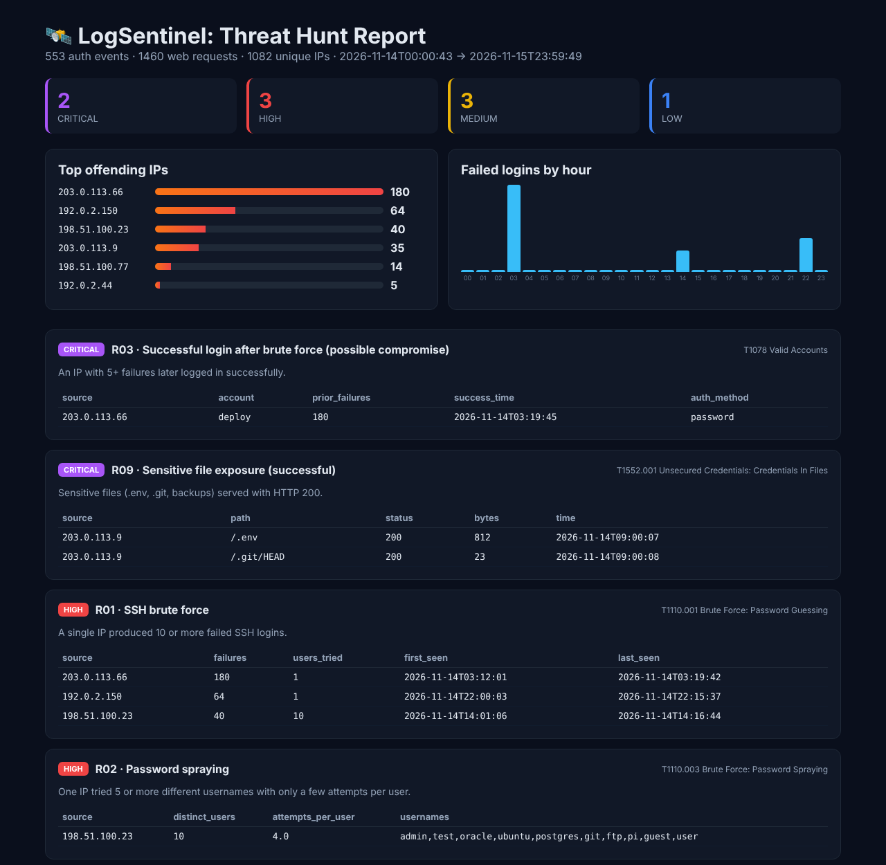
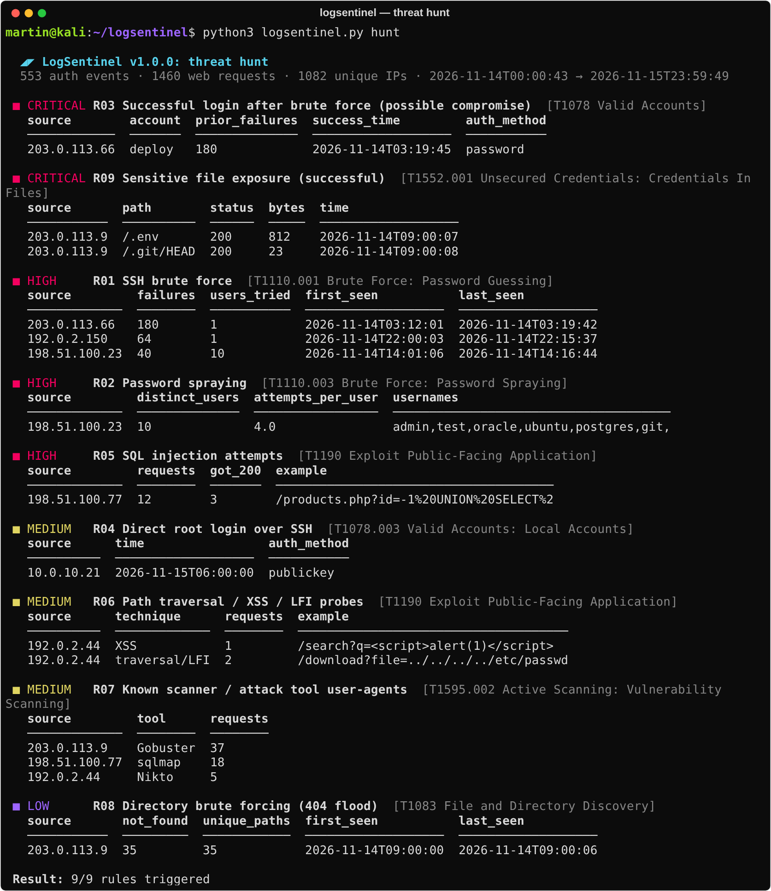
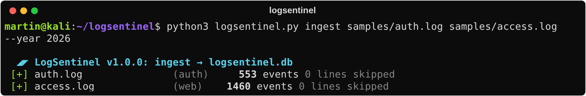
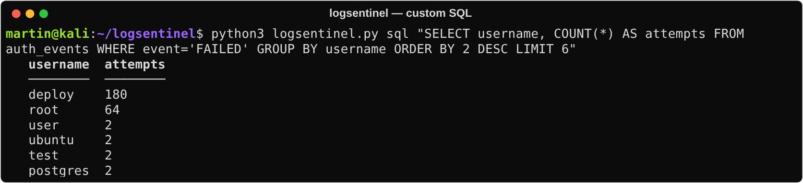
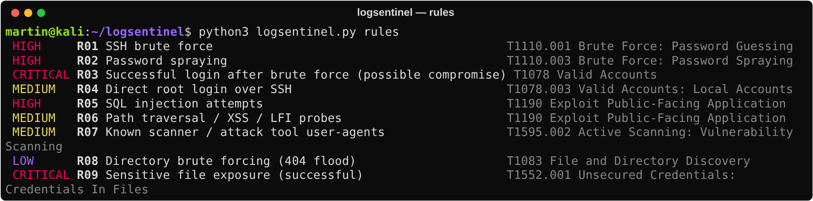

<div align="center">

# 🛰️ LogSentinel

**A mini-SIEM in one Python file: ingest logs into SQLite, hunt threats with plain SQL, map hits to MITRE ATT&CK.**




</div>

---

## 📖 Why?

As a pentester (eJPT), I know what attacks look like **from the attacker's side**: Hydra brute force,
password spraying, Gobuster, sqlmap, Nikto. I built LogSentinel to answer the question from the
**defender's side**: *what traces does each attack leave in the logs, and how do you catch it?*

LogSentinel turns raw logs into a SQL database, so every detection is a readable SQL query you can
understand, change and extend. You don't need to learn a proprietary query language (SPL, KQL) to start.

## ✨ Features

- 📥 **Parsers** for Linux `auth.log` (sshd and sudo) and Apache/Nginx **combined** access logs, with auto-detection
- 🗄️ **SQLite storage** with indexed tables (`auth_events`, `web_requests`)
- 🔎 **9 detection rules in pure SQL** with severity and **MITRE ATT&CK** mapping:

| Rule | Detects | ATT&CK |
|---|---|---|
| R01 | SSH brute force (≥10 failures from one IP) | T1110.001 |
| R02 | Password spraying (many users, few attempts each) | T1110.003 |
| R03 | 🚨 **Successful login after brute force** (likely compromise) | T1078 |
| R04 | Direct root SSH login | T1078.003 |
| R05 | SQL injection payloads | T1190 |
| R06 | Path traversal / LFI / XSS probes | T1190 |
| R07 | Attack tool User-Agents (sqlmap, Nikto, Gobuster, Nmap, WPScan, Hydra) | T1595.002 |
| R08 | Directory brute forcing (404 flood) | T1083 |
| R09 | 🚨 **Sensitive files served** (`.env`, `.git`, backups) | T1552.001 |

- 🖥️ **Colourful terminal hunt** and a 🌐 **HTML dashboard** (top offenders, failed logins per hour, findings)
- 🧑‍💻 **`sql` command** for ad-hoc threat hunting with your own queries
- 🤖 **CI-friendly** exit codes: `hunt` returns 1 when any rule fires
- 📦 **Zero dependencies:** Python standard library only (`sqlite3`, `re`, `argparse`)

## 📸 Screenshots

**Threat hunt in the terminal**



<table><tr>
<td width="50%"><b>Ingesting logs</b><br></td>
<td width="50%"><b>Ad-hoc SQL hunting</b><br></td>
</tr></table>

---

## 🚀 Tutorial

### 1. Install

```bash
git clone https://github.com/Martun1/logsentinel.git
cd logsentinel
python3 logsentinel.py --help
```

### 2. Get some logs

**Option A, demo data:** the repo includes realistic logs from two days on a web server, with
**5 hidden attack scenarios**. Regenerate them at any time:

```bash
python3 samples/generate_samples.py
```

**Option B, your own server or lab VM:**

```bash
sudo cp /var/log/auth.log ./my-auth.log              # Debian/Ubuntu/Kali
sudo cp /var/log/nginx/access.log ./my-access.log    # or /var/log/apache2/access.log
```

> 💡 Lab tip: attack your own Metasploitable / DVWA VM with Hydra, Gobuster and sqlmap, then feed
> its logs into LogSentinel and check whether every attack is detected.

### 3. Ingest

```bash
python3 logsentinel.py ingest samples/auth.log samples/access.log --year 2026
```

The file type is detected automatically. Syslog lines have no year, so pass it with `--year`.
Use `--reset` to clear the database first.

### 4. Hunt

```bash
python3 logsentinel.py hunt          # only rules that fired
python3 logsentinel.py hunt --all    # also show clean rules
```

In the demo data you should find an attacker (`203.0.113.66`) who brute-forced the `deploy` account
**180 times, got in, and then used sudo to download a script.** Can you confirm it with SQL? 👇

### 5. Investigate with your own SQL

```bash
python3 logsentinel.py sql "SELECT ts, event, username, method FROM auth_events
                            WHERE src_ip='203.0.113.66' OR username='deploy' ORDER BY ts DESC LIMIT 5"
```

Some useful hunting queries:

```sql
-- Which accounts are attacked the most?
SELECT username, COUNT(*) FROM auth_events WHERE event='FAILED' GROUP BY 1 ORDER BY 2 DESC;

-- Every sudo command run by an account that was brute-forced
SELECT ts, username, method AS command FROM auth_events WHERE service='sudo' AND username='deploy';

-- Requests per minute from one IP (find automated tools)
SELECT SUBSTR(ts,1,16) AS minute, COUNT(*) FROM web_requests WHERE src_ip='203.0.113.9' GROUP BY 1;
```

### 6. Generate the report

```bash
python3 logsentinel.py report -o report.html
```

Open `report.html` in any browser. It's a single file with no internet needed, so you can attach it to an incident ticket.

---

## 🧩 Write your own detection rule

Drop a `.sql` file into `rules/`. The header comments become the rule's metadata:

```sql
-- title: Login outside working hours
-- severity: LOW
-- mitre: T1078 Valid Accounts
-- description: Successful logins between 00:00 and 05:00.
SELECT username, src_ip AS source, ts
FROM auth_events
WHERE event = 'ACCEPTED' AND CAST(SUBSTR(ts, 12, 2) AS INT) < 5;
```

Run `python3 logsentinel.py rules` to check that it loaded:



## 🗄️ Database schema

```
auth_events   (id, ts, host, service, event, username, src_ip, method, raw)
web_requests  (id, ts, src_ip, method, path, status, bytes, user_agent, raw)
```

`event` ∈ `FAILED`, `ACCEPTED`, `INVALID_USER`, `SUDO`. The full schema is in [`schema.sql`](schema.sql).

## 🧪 Tests

```bash
python3 -m unittest discover -s tests -v
```

GitHub Actions runs the tests on Python 3.10 and 3.12 and checks that the demo compromise is always detected.

## 🗺️ Roadmap

- [ ] Windows Event Log (4625/4624) via exported CSV
- [ ] Time-window rules (N events in M minutes) with SQL window functions
- [ ] GeoIP / threat-intel enrichment
- [ ] Sigma rule → SQL converter

## ⚖️ Disclaimer

Analyse only logs you own or are authorized to handle. Demo data uses RFC 5737 documentation IP ranges.

---

<div align="center">
Made by <a href="https://github.com/Martun1">Martin Ivanov</a> · eJPT · CCNA · Computer Science @ NBU
</div>
